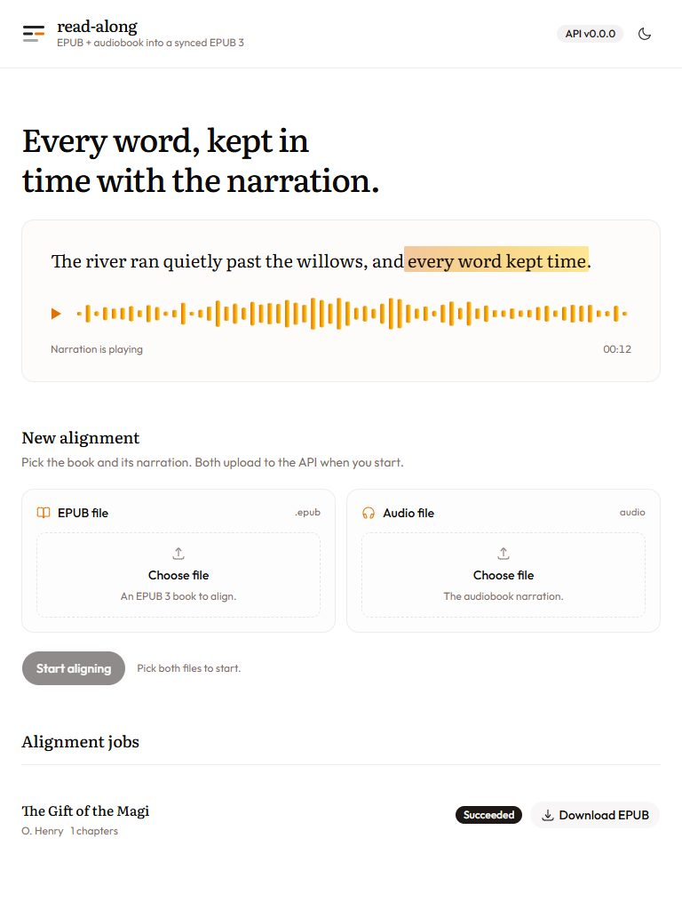

<div align="center">

# read-along

Turn an EPUB and its audiobook into a read-along EPUB 3.

[Get started](#run-locally) · [Try a real book](#try-a-real-book) · [API documentation](services/api/README.md)

</div>

<p align="center">
  <a href="https://react.dev"></a>
  <a href="https://www.typescriptlang.org"></a>
  <a href="https://vite.dev"></a>
  <a href="https://tailwindcss.com"></a>
  <br>
  <a href="https://www.python.org"></a>
  <a href="https://fastapi.tiangolo.com"></a>
  <a href="https://tanstack.com/query/latest"></a>
  <a href="https://pnpm.io"></a>
</p>

read-along embeds the narration and sentence timings in a single EPUB. Open the
result in a reader that supports EPUB Media Overlays to hear the audio and follow
the matching text.

This is a local prototype. Matching uses a transcript, not acoustic forced
alignment, and timing accuracy still needs manual checking.

<picture>
  <source media="(prefers-color-scheme: dark)" srcset="docs/images/read-along-dark.jpg">
  <source media="(prefers-color-scheme: light)" srcset="docs/images/read-along-light.jpg">
  
</picture>

<sub>Actual app screenshots, captured with the Gift of the Magi benchmark fixtures
and a cached transcript. The narration sample at the top is illustrative, not an
in-app reader. The image follows your light or dark theme.</sub>

## What it does

- Accepts an EPUB 3 book and one MP3, M4A, or M4B narration file.
- Extracts text in reading order, transcribes the audio locally, and matches
  sentences to word timestamps.
- Adds sentence anchors and SMIL Media Overlays to a new EPUB without overwriting
  the uploaded book.
- Shows upload progress and live job stages, with recovery after a dropped
  connection and cancellation that stops the job's worker process.
- Rejects incomplete or invalid sentence timings instead of exporting a partial
  result.

The export check requires a timing for every extracted sentence. That does not
mean every word matched or every highlight boundary is accurate.

## Tech stack

- The interface uses React 19, TypeScript 6, Vite 8, and Tailwind CSS 4.
  [shadcn/ui](https://ui.shadcn.com) on Base UI provides components;
  TanStack Query handles API state and live-job recovery.
- The API uses Python 3.12+, FastAPI, Pydantic, and Uvicorn. Each job runs in a
  separate, cancellable process.
- [faster-whisper](https://github.com/SYSTRAN/faster-whisper) uses CTranslate2 and
  PyAV for transcription. pySBD finds sentence boundaries; Python's `difflib`
  matches the book text to the transcript.
- Vitest and Testing Library test the web hooks; pytest tests the API and EPUB
  pipeline. TypeScript, ESLint, and Ruff check the code. EPUBCheck runs during
  export when installed.

## Run locally

You need Python 3.12+, pnpm 10, and a current patch release of Node 22 or 24 LTS,
or Node 26. The repository pins pnpm 10.28.2 in `package.json`.

```sh
git clone https://github.com/aungzm/read-along.git
cd read-along
pnpm install
```

### 1. Start the API

From the repository root:

<details open>
<summary>Windows</summary>

These commands work in Command Prompt and PowerShell. Activation is not needed.

```powershell
cd services\api
python -m venv .venv
.\.venv\Scripts\python.exe -m pip install -e ".[dev,transcribe]"
.\.venv\Scripts\python.exe -m uvicorn app.main:app --reload --port 8000
```

</details>

<details>
<summary>macOS and Linux</summary>

```sh
cd services/api
python3 -m venv .venv
.venv/bin/python -m pip install -e ".[dev,transcribe]"
.venv/bin/python -m uvicorn app.main:app --reload --port 8000
```

</details>

The `transcribe` extra is required for actual audio jobs. The default
`small.en` model downloads on first use and runs on the CPU. Transcription can
take several minutes or longer, depending on the recording and your machine.

### 2. Start the web app

In a second terminal, from the repository root:

```sh
pnpm dev
```

Open [localhost:5173](http://localhost:5173). The dev server forwards `/api`
requests to the API on port 8000. Interactive API docs are at
[localhost:8000/docs](http://localhost:8000/docs).

### 3. Align a book

Choose the EPUB and its matching narration, then select **Start aligning**.
After the job succeeds, download the EPUB and open it in a Media Overlay-capable
reader. Check passages near the beginning, middle, and end by listening.

The web app creates the EPUB; it does not play the exported book itself.

## Try a real book

The benchmark downloads public-domain text from Project Gutenberg and narration
from LibriVox via Archive.org. It builds an EPUB fixture, performs real
transcription, and exercises the upload, processing, and download endpoints.
No separate API server is needed.

From `services/api`:

```powershell
.\.venv\Scripts\python.exe -m benchmarks.real_books --pair gift-of-the-magi
```

On macOS/Linux, use `.venv/bin/python` in place of
`.\.venv\Scripts\python.exe` here and in the API checks below.

On success, the output is
`services/api/benchmarks/data/gift-of-the-magi/result.epub`.
The run also saves `transcript.json` for the story and a shared `report.json`
with coverage, unmatched sentences, and timings under `benchmarks/data/`.
Downloaded fixtures and results stay out of Git.

*The Gift of the Magi* has passed the real-transcription benchmark locally.
That is one short English story, not evidence of reliable alignment across all
books. Downloads also depend on the source sites being available.

See the [benchmark guide](services/api/benchmarks/README.md) for both story pairs,
source credits, preparation-only runs, and pass criteria. Check public-domain
status in your country before using the fixtures.

## Development

From the repository root:

| Command | Purpose |
| --- | --- |
| `pnpm dev` | Start the web dev server. |
| `pnpm test` | Test job events and browser recovery. |
| `pnpm typecheck` | Check web TypeScript. |
| `pnpm lint` | Lint the web app. |
| `pnpm build` | Build the web app for production. |

From `services/api`:

```powershell
.\.venv\Scripts\python.exe -m pytest
.\.venv\Scripts\python.exe -m ruff check .
```

The ordinary tests run without downloading books or speech models. Real
transcription is a separate benchmark. The manual
[Real-book benchmarks workflow](.github/workflows/real-books.yml) runs it with
EPUBCheck and retains reports as workflow artifacts.

### Repository layout

```text
apps/web/                 React interface and job-state hooks
services/api/app/         API routes, job workers, alignment, and EPUB packaging
services/api/tests/       API and pipeline regression tests
services/api/benchmarks/  Downloadable fixtures and real-transcription runs
docs/images/             README screenshots
```

## Current limits

- The transcription defaults and word matcher target English. Language-aware
  sentence splitting does not make the full pipeline multilingual.
- Inputs must be EPUB 3. There is no EPUB 2 conversion or DRM removal.
- Long books, complex layouts, edition differences, and timing accuracy need
  broader testing. A passing coverage check is not an acoustic accuracy score.
- Jobs live in memory. Reloading or restarting the API loses the job list and
  download links, even though uploaded files and results remain on disk.
- Run one API worker. Processes do not share job metadata or queue limits.
- There is no authentication, job ownership, or automatic cleanup of finished
  job files.
  Keep it local; upload and processing limits do not make it ready for public
  hosting.
- Without EPUBCheck, export validation is structural, not a full EPUB
  conformance check.

Copy [`services/api/.env.example`](services/api/.env.example) to
`services/api/.env` to configure storage, CORS, upload sizes, and job limits.
See the [API guide](services/api/README.md) for defaults and worker behavior.

## License

No license has been selected yet.
